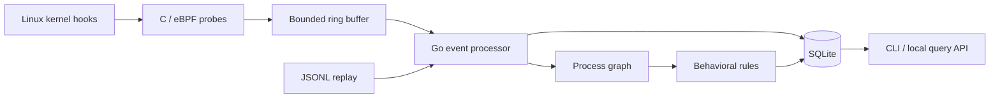

<div align="center">

# Vigil

**Linux Endpoint Security Sensor**

Kernel telemetry → process history → behavioral detections


[Run the demo](#run-the-demo) · [Architecture](#architecture) · [Tests](#tests) · [Author](https://github.com/vishalshetagar)

</div>

Vigil records Linux process and connection activity, links events to process lifetimes, and produces behavioral alerts with the evidence that triggered them. The kernel probes are written in **C**, and the collector, detection engine, database, and CLI are written in **Go**.

I built this project to work through the systems problems behind endpoint security: PID reuse, thread lifecycles, event loss, bounded state, and preserving an alert's evidence after the original process has exited.

## What it does

- **Captures process lifecycles:** fork, successful exec, thread exit, and last-thread exit.
- **Tracks process identity:** host ID, boot ID, host PID, and kernel birth time distinguish separate lifetimes of the same PID.
- **Attributes connection attempts:** IPv4/IPv6 `connect` calls include the destination and syscall result, including failure and `EINPROGRESS`.
- **Evaluates four detection rules:** alerts include a rule ID, severity, process key, explanation, and triggering events.
- **Stores investigation history:** SQLite retains events, process snapshots, and alerts; the CLI queries them live or offline.
- **Replays recorded events:** the same Go engine processes live telemetry and JSONL fixtures, making detections reproducible.

## Run the demo

Requires **Go 1.26.3**. Run these commands from the repository root; this demo needs neither Linux nor root privileges.

```sh
go build -o bin/vigil ./cmd/vigil
./bin/vigil rules validate
./bin/vigil replay --input testdata/replay/demo.jsonl --db demo.db
./bin/vigil status --db demo.db
```

The [included fixture](testdata/replay/demo.jsonl) contains seven events: a server launches a shell, the shell initiates a connection, and a downloader execution precedes execution from `/tmp`. It produces **four alerts**. The final command reports:

```json
{"events":7,"processes":4,"alerts":4}
```

Inspect the evidence and the process history:

```sh
./bin/vigil alerts --db demo.db
./bin/vigil ps --db demo.db
./bin/vigil inspect --db demo.db --process demo-host/demo-boot/103/400
./bin/vigil timeline --db demo.db --process demo-host/demo-boot/103/400
```

Selected fields from the demo's connection alert:

```json
{
  "rule": "VIGIL-003",
  "severity": "medium",
  "process_key": "demo-host/demo-boot/101/200",
  "summary": "Shell or interpreter initiated an outbound connect (pending)"
}
```

The complete alert also embeds the exec and connect events. `pending` reflects the syscall's `EINPROGRESS` result; it does not assert that a connection was established.

Replay prints one alert per line to stdout and counters to stderr. Database queries return JSON arrays in newest-first order. Repeating the demo preserves stored IDs without duplicating rows; replay still prints its evaluation. Use a new `demo.db` to reproduce the counts above if the file already contains other data.

**PowerShell:** build with `go build -o bin/vigil.exe ./cmd/vigil`, then use `./bin/vigil.exe` in the commands above.

## Architecture



| Engineering problem | Implementation |
| --- | --- |
| A PID can identify different processes over time | Process keys include boot and birth identity; exec generations are scoped to a sensor run. |
| A thread can exit while its process continues | The exit probe reads thread-group state; only the last-thread exit closes the process. |
| The kernel can produce events faster than userspace consumes them | Bounded buffers and maps, explicit loss counters, and coverage warnings on alerts. |
| Cross-CPU records can arrive late | Raw history retains late records; the engine counts them and skips state/rule updates that would overwrite newer observations. |
| An alert must remain explainable | Events, process changes, and alerts commit transactionally; alerts retain their evidence after raw-event retention. |
| Kernel structure offsets vary | CO-RE relocations use the running kernel's BTF. The compiled BPF object is embedded in the Go binary. |

**Code map:** [kernel probes](bpf/sensor.bpf.c) · [event ABI](bpf/include/events.h) · [process graph](internal/process/graph.go) · [rules](internal/detect/engine.go) · [storage](internal/store/store.go) · [live pipeline](internal/pipeline/pipeline.go)

## Detection rules

| Rule | Trigger | Evidence boundary |
| --- | --- | --- |
| **VIGIL-001** | A configured server ancestor launches a shell | Requires observed executable ancestry. |
| **VIGIL-002** | Successful exec reports a filename under `/tmp`, `/var/tmp`, or `/dev/shm` | A path heuristic; file contents and resolved file identity are not inspected. |
| **VIGIL-003** | A configured shell/interpreter calls connect within 30 seconds of exec | Reports the syscall outcome, not a confirmed reverse shell. |
| **VIGIL-004** | Downloader exec is followed by temporary-path exec under the same immediate creator within 30 seconds | Correlates behavior; it does not prove that the downloaded file was executed. |

[Default rules](internal/detect/default.yaml) use YAML with configurable executable sets, directories, windows, severities, and cooldowns. Validate a custom file before using `--rules FILE` with `run` or `replay`. Rules are loaded at startup; changes require a restart.

## Live Linux capture

Requires **Linux amd64**, kernel BTF at `/sys/kernel/btf/vmlinux`, BPF ring buffers, scheduler/connect tracepoints, and privileges to load probes. `doctor` checks these by loading and attaching the actual programs, then cleaning them up.

The checked-in BPF object means a normal Go build requires no runtime C compiler.

```sh
sudo ./bin/vigil doctor
sudo ./bin/vigil run --config configs/vigil.yaml
```

In a second terminal:

```sh
sudo ./bin/vigil status
sudo ./bin/vigil events --type exec --limit 20
sudo ./bin/vigil alerts --limit 20
sudo ./bin/vigil ps
```

Stop with **Ctrl+C** to detach probes, drain queued records, commit the final batch, and remove the socket. `--duration 30s` provides a timed capture. Alerts reach stdout after commit. A persistence failure stops capture and returns an error.

[Configuration](configs/vigil.yaml) sets a **16 MiB ring**, **8,192-event queue**, **32,768-process graph**, and retention of **50,000 events / 10,000 alerts** by default. Retention is row-based. The local query API uses an owner-only Unix socket at `/run/vigil/vigil.sock`; the database defaults to `/var/lib/vigil/history.db`.

Use process keys from `ps` for inspection. Event PIDs are host-kernel IDs and can differ from PIDs inside a container or WSL distribution. Probes observe the shared Linux kernel, including activity outside the launching PID namespace.

## Tests

Verified locally with **Go 1.26.3**, **Windows amd64** for replay/offline queries, and **Ubuntu WSL2 amd64, kernel `6.18.33.2-microsoft-standard-WSL2`** for live capture.

```sh
go test ./...
go vet ./...
```

On Linux, also run the race detector and decoder fuzzer:

```sh
go test -race ./...
go test ./internal/event -fuzz=FuzzDecode -fuzztime=10s -parallel=2
```

Real-kernel tests need root/BPF privileges and a C compiler (`cc`):

```sh
mkdir -p bin
go test -race -c -o bin/integration.test ./tests/integration
(cd tests/integration && sudo env VIGIL_INTEGRATION=1 \
  ../../bin/integration.test -test.v -test.timeout=60s)
```

| Test layer | Cases covered |
| --- | --- |
| [Unit tests](internal) | PID reuse, creator identity, late events, rule expiry/negative cases, malformed input, bounded state, storage rollback, retention, and socket ownership. |
| [CLI tests](internal/cli/cli_test.go) | Demo alerts, database counts, process inspection, timeline queries, and invalid arguments. |
| [Kernel integration](tests/integration/kernel_test.go) | Fork/exec/exit, non-leader exec, leader exit before worker exit, failed exec, IPv4/IPv6 connect outcomes, live queries, shutdown, and restart. |
| [Overload test](tests/integration/kernel_test.go) | A deliberately full 4 KiB ring increments loss counters and still drains. |

Ordinary `go test ./...` skips privileged integration; the command above explicitly enables it. The [CI workflow](.github/workflows/ci.yml) defines Windows/Linux checks and a separate privileged Linux job.

To rebuild the kernel object after editing C, install Clang, LLVM, and libbpf development headers, then run:

```sh
make generate
make build
```

The current object was generated with **Clang 21.1.8** and **libbpf headers 1.6.3**. Go dependencies are pinned in [`go.mod`](go.mod) and [`go.sum`](go.sum).

## Scope

Vigil is an observational sensor: it records and alerts; it does not block execution or kill processes.

- Collection begins at attachment. There is no startup `/proc` snapshot, argv/environment capture, file monitoring, or credential-change telemetry.
- Network visibility covers `connect` syscall outcomes, not inbound traffic, UDP `sendto`, established flows, or `io_uring` operations.
- Committed history survives restart. The live graph and rule state restart empty, with an explicit observation gap.
- Live capture is implemented for Linux amd64. Other kernels, arm64, sustained throughput, and long-duration soak behavior have not been validated.

The next milestones are bounded argv capture, startup process reconciliation, and a broader kernel test matrix. An optional [systemd unit](packaging/systemd/vigil.service) is included as a root-service development profile.

---

Built by [**@vishalshetagar**](https://github.com/vishalshetagar) · Go, C, Linux internals, and defensive security
